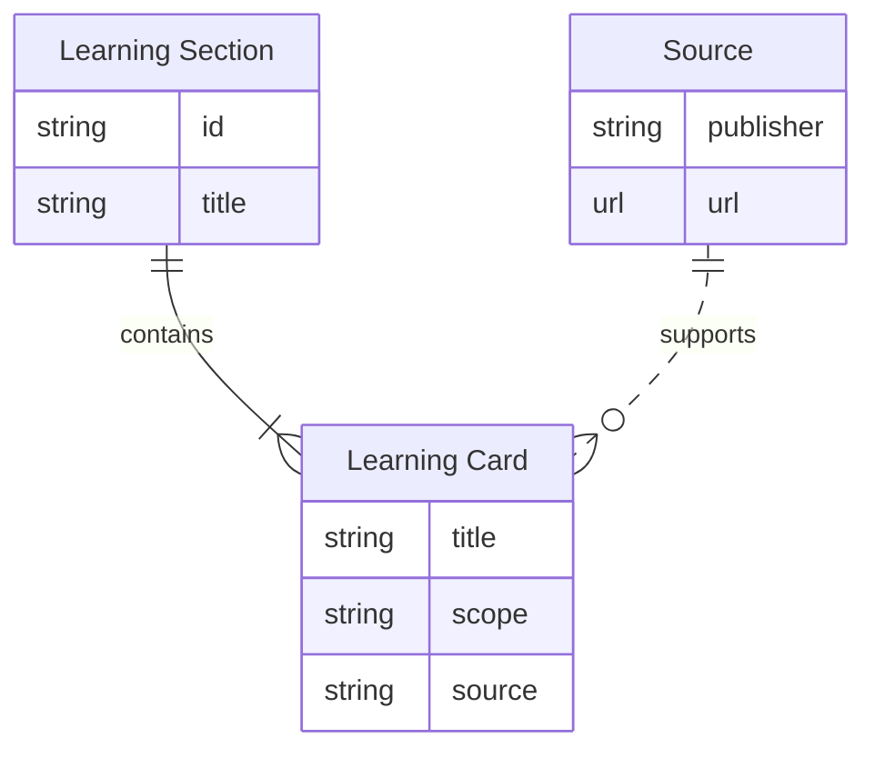
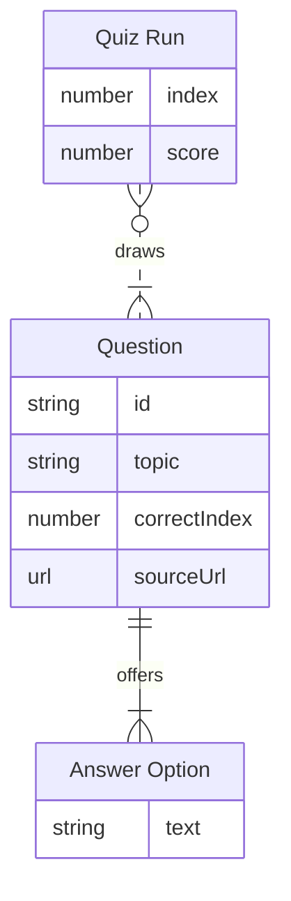

# Know Dublin

A source-linked educational website about Dublin, the River Liffey, its bridges and civic history.

**HTML · CSS · JavaScript**

[Visit the website](https://samobrienolinger.github.io/dublin-city-bridges-frontend/) · [Getting started](#getting-started) · [Data model](#entity-relationship-diagrams) · [Repository guide](#repository-guide) · [Checks](#checks-and-review) · [Credits](#credits-and-reuse)

## What you can explore

- Learning cards covering local history and engineering.
- Ten shuffled questions selected from a sourced question bank.
- Explanations, source links and a device-local best score.
- Contact, privacy and About pages.

## Using the project

1. Browse the Learn page for bridge, river and city stories.
2. Answer ten shuffled quiz questions and read the source-linked explanations.
3. Replay to try another selection from the question bank.

> **Project notes:** This independent educational prototype is not a Dublin City Council product. The contact form demonstrates local validation and does not send messages.

## Entity relationship diagrams

### Learning cards and sources

The static site groups learning cards into sections on local history and engineering. Each card uses a key into the shared source directory. [Learning content and sources](assets/data/content.js)



### Quiz

A quiz run samples ten approved questions without repeats. Each question has four choices, a correct option index and a source link. The static site keeps the best score on the device. [Question bank](assets/data/questions.js) · [Quiz engine](assets/js/quiz-engine.js) · [Browser storage](assets/js/quiz.js)



## Getting started

Requires Git, a browser and a local HTTP server. Python 3 provides one without installing application packages.

```bash
git clone https://github.com/SamOBrienOlinger/dublin-city-bridges-frontend.git
cd dublin-city-bridges-frontend
python3 -m http.server 8000 --bind 127.0.0.1
```

Open [localhost:8000](http://localhost:8000). Serve the repository over HTTP so module imports, relative assets and page links resolve correctly.

The existing `npm run serve` command is another development-server option. See [package.json](package.json) for its port and Node.js requirement.

## Repository guide

| Path | Purpose |
| --- | --- |
| [index.html](index.html) | Primary browser entry point |
| [assets/](assets/) | Project styles, scripts, data and imagery |
| [tests/](tests/) | Automated test source |
| [.github/workflows/](.github/workflows/) | Build, test or deployment workflows |
| [package.json](package.json) | Package dependencies and available commands |

## Checks and review

Use Node.js `>=20` and npm for the package commands below. Install the package dependencies first when the command uses a local build or test tool.

| Command | Purpose |
| --- | --- |
| `npm test` | Run the existing test suite |

For a manual review, follow the main user journey, check keyboard navigation and narrow-screen layouts, and inspect the browser console for missing assets or failed requests.

Supporting notes: [TESTING.md](TESTING.md).

Generate fresh results from the revision you are working on; historical test reports describe earlier runs.

## Deployment

A GitHub Pages site is configured for this repository. Its published URL is linked at the top of this README.

Review [.github/workflows/pages.yml](.github/workflows/pages.yml) before changing the publishing workflow or source directory.

## Credits and reuse

Design decisions, original feature notes, historical testing evidence and detailed acknowledgements remain available in the preserved project record:

- [README.md · original project record](https://github.com/SamOBrienOlinger/dublin-city-bridges-frontend/blob/f30080980dbdf4255ab8b82242d4eab54d8d278d/README.md)

Reuse terms are recorded in [LICENSE](LICENSE). Third-party assets and dependencies retain their own terms.

## Support

Repository maintained in [Sam O’Brien-Olinger’s GitHub account](https://github.com/SamOBrienOlinger). For a problem or suggested improvement, [open an issue](https://github.com/SamOBrienOlinger/dublin-city-bridges-frontend/issues) with the affected page or command, steps to reproduce, and expected behaviour.

[Back to top](#know-dublin)
